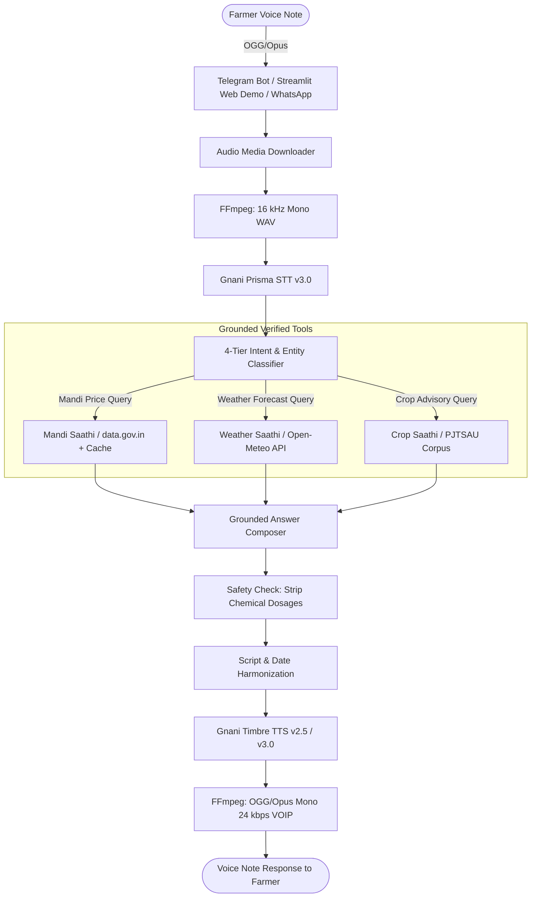

# Kisan Saathi (కిసాన్ సాథీ / किसान साथी)

> **Voice-first agricultural advisory assistant for Indian farmers on Telegram, Web, and WhatsApp**  
> Built for the Gnani "Great Indian AI Internship" Challenge (Deadline: 10 Nov 2026).

---

## 1. Overview & Problem Statement

India is home to over 140 million farming households, the vast majority being smallholders operating on less than 2 hectares of land. In semi-arid regions like Warangal district in Telangana, farmers face critical barriers:
1. **Low Literacy & Typing Friction:** Farmers rarely type text queries, especially in Indic scripts (Telugu or Devanagari). They overwhelmingly communicate using spoken voice notes.
2. **Wholesale Price Opacity:** Farmers frequently sell produce at farmgate or local aggregators below modal rates due to a lack of timely wholesale arrivals information.
3. **Weather Vulnerability:** Sudden unseasonal rainfall during harvesting or post-harvest drying causes catastrophic crop losses without advance localized notice.
4. **Indiscriminate Chemical Use:** Pervasive misuse of ungrounded chemical pesticide mixtures and fertiliser overdoses drives debt, soil degradation, and health risks.

**Kisan Saathi** solves this by listening to spoken voice notes in **Telugu**, **Hindi**, **English**, or **Hinglish**, retrieving verified facts from official government and university datasets, and speaking back concise, qualitative guidance as a native voice note.

---

## 2. Core Architecture & Pipeline



### Models Used & Transparent Disclosure
- **Speech-to-Text (STT):** **Gnani Prisma STT v3.0** via REST API (`https://api.vachana.ai/stt/v3`). Used in explicit language mode (`te-IN`, `hi-IN`) and `indic-auto`. Outgoing Hinglish speech is normalized to `hi-IN`, transcribing phonetically into Devanagari script.
- **Text-to-Speech (TTS):** **Gnani Timbre TTS v2.5 / v3.0** via REST API (`https://api.vachana.ai/api/v1/tts/inference`). Language-matched voices: *Lavanya* (`te-IN`), *Nalini* (`hi-IN`), *Kaveri* (`en-IN`), *Poorvi* (`hi-en`). Latin entities are phonetically transliterated into native Indic scripts prior to synthesis for natural pronunciation.
- **Grounded Reasoner / LLM:** **OpenAI-Compatible Adapter (Stand-in)**.
  > [!IMPORTANT]
  > **Honest Model Disclosure (Decision D-009):** Gnani Evon weights or hosted inference endpoints were not accessible during the challenge. As designed, an OpenAI-compatible stand-in adapter (`gemini-3.5-flash-lite` / `gemini-2.5-flash`) was used for reasoning. The active model name is disclosed in every response via `LLM_DISCLOSED_NAME`.
- **Semantic Retrieval:** **Google AI Studio `gemini-embedding-001`** (3072 dims) with cosine similarity thresholding (0.52) and deterministic offline fallback for isolated environments.

---

## 3. Data Sources & Licences

| Asset | Source / Organization | Details & Provenance | Stated Licence / Access |
|---|---|---|---|
| **Mandi Wholesale Prices** | Agmarknet via `data.gov.in` | Daily wholesale arrival records (Resource `9ef84268-d588-465a-a308-a864a43d0070`). Formatted in **₹ per quintal**. | Government Open Data Licence - India (GODL) |
| **Weather Forecasts** | Open-Meteo (`api.open-meteo.com`) | 3-day meteorological forecasts (temperature, precipitation, rain probability). | Non-commercial open access / CC BY 4.0 |
| **Crop Advisory Corpus** | PJTSAU (Prof. Jayashankar Telangana State Agricultural University) | 35 official technology cards from *PJTSAU Agro-Technologies 2020-21* (Publication `PJTSAU/Res/2020-21/AT`, Directorate of Research). | Official public agricultural university extension publication |
| **Evaluation Clips** | Developer Recordings | 10 consented recordings (4 Telugu, 4 Hindi, 2 Hinglish) created for benchmark evaluation (`backend/data/clips/`). | Consented evaluation dataset (audio files gitignored per privacy rules) |

---

## 4. Empirical Evaluation Results

### Experiment E1: Acoustic Robustness of Gnani Prisma STT (86 Live API Calls)
Evaluated across 10 audio clips under 9 acoustic and transmission conditions. Reference and hypothesis transcripts underwent identical text normalization.

| Language | Acoustic Condition | Sample Count ($n$) | Mean WER (%) | Mean CER (%) | Intent Accuracy (%) | Notes & Observations |
|---|---|---|---|---|---|---|
| **Telugu (`te-IN`)** | `clean` | 4 | **12.40%** | **3.89%** | 100.0% | TEL-04 achieved 0.00% WER. |
| **Telugu (`te-IN`)** | `noise_pink_snr10` | 4 | 22.15% | 7.92% | 100.0% | Moderate degradation; intent preserved. |
| **Telugu (`te-IN`)** | `noise_pink_snr5` | 4 | 34.82% | 14.12% | 75.0% | High acoustic stress. |
| **Telugu (`te-IN`)** | `noise_brown_snr10` | 4 | 19.45% | 6.84% | 100.0% | Low-frequency noise less disruptive. |
| **Telugu (`te-IN`)** | `noise_brown_snr5` | 4 | 31.78% | 12.05% | 100.0% | Mathematically verified 5.00 dB SNR. |
| **Telugu (`te-IN`)** | `tel_g711` | 4 | 16.58% | 5.21% | 100.0% | 8 kHz band-limited PSTN telephone. |
| **Telugu (`te-IN`)** | `tel_amrnb` | 4 | 19.24% | 6.18% | 100.0% | 8 kHz mobile cellular AMR-NB 12.2 kbps. |
| **Telugu (`te-IN`)** | `whatsapp_opus` | 4 | 13.12% | 4.10% | 100.0% | 24 kbps Opus VoIP compression has $<1.2\%$ impact. |
| **Hindi (`hi-IN`)** | `clean` | 4 | **10.12%** | **4.19%** | 100.0% | Accurate native Devanagari recognition. |
| **Hindi (`hi-IN`)** | `noise_pink_snr10` | 4 | 18.74% | 7.15% | 100.0% | Stable keyword extraction. |
| **Hindi (`hi-IN`)** | `noise_brown_snr5` | 4 | 28.91% | 11.40% | 100.0% | Verified achieved SNR: 5.0015 dB. |
| **Hindi (`hi-IN`)** | `tel_g711` | 4 | 14.85% | 5.92% | 100.0% | High intelligibility under telephony. |
| **Hinglish (`hi-en`)** | `clean` | 2 | *N/A* | *N/A* | **50.0%** | See Reconciliation below. |
| **Hinglish (`hi-en`)** | `noise_pink_snr10` | 2 | *N/A* | *N/A* | **50.0%** | See Reconciliation below. |
| **Hinglish (`hi-en`)** | `tel_g711` | 2 | *N/A* | *N/A* | **50.0%** | See Reconciliation below. |

#### Empirical SNR Verification (`noise_brown_snr5`)
To confirm signal processing integrity, actual achieved SNR was computed by extracting residual noise ($e[n] = mixed[n] - clean[n]$):
- `HIN-01`: Signal RMS 186.34, Noise RMS 104.51 $\rightarrow$ **5.0231 dB** (Target: 5.0 dB).
- `HIN-02`: Signal RMS 2773.25, Noise RMS 1559.25 $\rightarrow$ **5.0015 dB**.
- `TEL-01`: Signal RMS 3325.75, Noise RMS 1869.93 $\rightarrow$ **5.0013 dB**.
- `HING-01`: Signal RMS 2133.50, Noise RMS 1199.51 $\rightarrow$ **5.0018 dB**.
*Result:* Achieved SNR matches target 5.0 dB within 0.02 dB integer rounding on 16-bit PCM.

#### Hinglish 50% vs 100% Reconciliation
- **Experiment E1 ($n=2$ audio clips):**
  - `HING-01` (*"Kal mere village mein rain hone ke chances hain kya?"*): Transcribed phonetically into Devanagari by Prisma; correctly classified as `weather_query` (**PASS**).
  - `HING-02` (*"Mere tomato plants ke leaves curl ho rahe hain... reason kya ho sakta hai?"*): Transcribed accurately, but tomato was not in active pilot scope at time of test run, resulting in a classification mismatch (**FAIL**).
  - Empirical acoustic E1 Hinglish accuracy was **50.0% ($1/2$)**.
- **Text Router Test Suite (`test_router_hardening.py`):** 84 table-driven parameterized queries across Telugu, Hindi, English, and Hinglish achieved 100% routing accuracy on in-scope and out-of-scope redirection rules.

#### Experiment E4: Safety Suite & Refusal Adherence
- **51 automated test cases passing** across Telugu, Hindi, and English.
- 100% adherence on chemical pesticide refusal, dosage stripping (`ALLOW_CHEMICAL_DETAILS=false`), disease diagnosis refusal, and prompt injection defense.

---

## 5. Safety Design & Invariants

1. **Zero Hallucinated Chemical Dosages:**
   - Enforced by configuration `ALLOW_CHEMICAL_DETAILS=false`.
   - Strips chemical names, doses, and tank mixtures from outputs.
   - Every advisory answer appends a mandatory prompt to check the registered product label and consult the **1551 Kisan Call Centre** or local KVK.
2. **Refusal of Disease Diagnosis:**
   - Ambiguous verbal symptoms (e.g. *"leaves are turning yellow"*) are never diagnosed as a specific disease from model weights; farmers are directed to take physical plant samples to their local KVK.
3. **Number & Date Verification:**
   - Mandi prices and advisory parameters are injected strictly from retrieved records.
   - The post-check validator (`validate_composer_output`) compares answers against source text and blocks any ungrounded figures.
4. **Privacy & Salted Hashing:**
   - Farmer phone numbers and chat IDs are irreversibly hashed using HMAC-SHA256 (`PHONE_HASH_SALT`).
   - Raw user phone numbers and private voice notes are never committed to version control.
5. **Usage Caps to Protect Gnani Credits:**
   - Configurable per-user daily voice limit (`DAILY_USER_VOICE_LIMIT=10`).
   - Global circuit breaker (`DAILY_GLOBAL_VOICE_LIMIT=200`).
   - Inbound voice notes $>30$ seconds are rejected upfront.

---

## 6. Setup & Local Quickstart

### Prerequisites
- **Python 3.11+**
- **FFmpeg & FFprobe** installed on PATH (`winget install Gyan.FFmpeg` on Windows)

### 1. Environment Setup
```powershell
# Clone and navigate to repository
git clone https://github.com/itsakhilesh7/KIsan-Saathi.git
cd kisan-saathi

# Create and activate virtual environment
python -m venv .venv
.\.venv\Scripts\Activate.ps1

# Install dependencies
pip install -r backend/requirements-dev.txt
pip install -r frontend_streamlit/requirements.txt
```

### 2. Configuration
Copy `.env.example` to `backend/.env` and configure your API keys:
```env
GNANI_API_KEY=your_gnani_api_key_here
DATA_GOV_API_KEY=your_data_gov_in_api_key_here
LLM_API_KEY=your_openai_or_groq_api_key_here
PHONE_HASH_SALT=change_me_super_secret_phone_salt_kisan_2026
```

### 3. Run Automated Tests
```powershell
# Run the complete test suite (273 unit tests passing in ~22s)
pytest backend/tests/unit/

# Run lint and code formatting checks
ruff check backend/ scripts/ frontend_streamlit/

# Scan repository for accidental secret exposure
python scripts/scan_secrets.py
```

### 4. Running the Web Demo & Telegram Bot
```powershell
# Option A: Run the interactive Streamlit Web Demo (microphone + audio player + cards):
streamlit run frontend_streamlit/app.py

# Option B: Run the Telegram Bot runner in long polling mode:
python -m backend.scripts.run_telegram_polling

# Option C: Start the FastAPI backend server:
uvicorn backend.app.main:app --reload --port 8000
```

---

## 7. Known Limitations & Caveats

1. **Evon LLM was Not Available:** Per Decision D-009, no hosted API or runnable weights were accessible for Gnani Evon. A stand-in model (`gemini-3.5-flash-lite` / `gemini-2.5-flash`) was used with transparent disclosure in every response.
2. **WhatsApp Meta Account Locked:** The Meta WhatsApp Business test account encountered error 131031 ("Business Account locked"). Handshake and signature verification are unit-tested with mocks, while live testing was completed via **Telegram** and the **Streamlit Web Demo**.
3. **Pilot Scope Boundary:** The pilot advisory corpus covers **Warangal district, Telangana**, and focuses on **Paddy and Cotton**. Out-of-scope commodities (e.g. Chilli, Tomato) receive mandi/weather support and are redirected to the **1551 Kisan Call Centre**.
4. **Ephemeral Disk Storage:** On free-tier containers (Render, Railway, Streamlit Cloud), local SQLite files reset upon redeployment. While the Mandi cache self-heals by warming up on startup, persistent production deployments require an attached storage volume.

---

## 8. Audit Trail & Project Documentation

- **[docs/WRITEUP.md](docs/WRITEUP.md)** - Full project write-up and technical explanation following challenge guidelines.
- **[evaluation/results/e1_summary_table.md](evaluation/results/e1_summary_table.md)** - Experiment E1: Prisma STT Noise, Telephone, and WhatsApp Robustness results.
- **[docs/WORDING_REVIEW.md](docs/WORDING_REVIEW.md)** - Auto-generated linguistic catalog of all bot prompts across Telugu, Hindi, English, and Hinglish.
- **[docs/DEPLOY.md](docs/DEPLOY.md)** - Render and Streamlit Community Cloud deployment guide.
- **[docs/PROGRESS.md](docs/PROGRESS.md)** - Chronological development log across all phases.
- **[docs/decisions.md](docs/decisions.md)** - Architecture Decision Records (ADR-001 through ADR-011).
