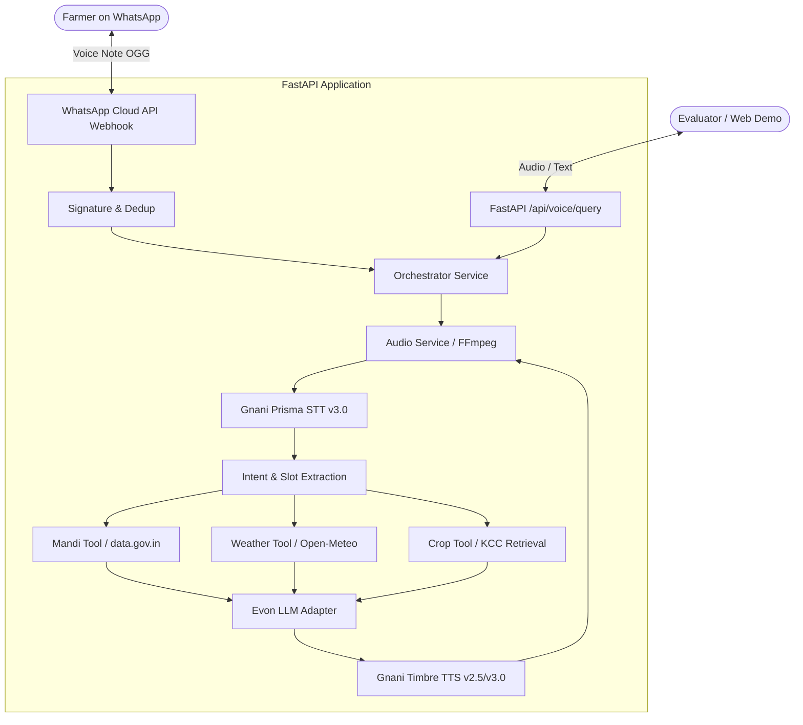

# Kisan Saathi (కిసాన్ సాథీ / किसान साथी)

> **Voice-first agricultural advisory assistant for Indian farmers on WhatsApp and Web**  
> Built for the Gnani "Great Indian AI Internship" challenge (November 2026).

---

## 1. What is Kisan Saathi?

Kisan Saathi is a source-grounded voice assistant designed specifically for Indian smallholder farmers. Farmers interact naturally by sending voice notes on WhatsApp in **Telugu**, **Hindi**, or **English** (with Hinglish support). The system listens, retrieves grounded facts from official data sources, reasons with an LLM, and speaks back a concise, actionable answer as an audio voice note.

### Core Pipeline
```
[ WhatsApp Voice Note (OGG/Opus) ]
                │
                ▼
      [ FFmpeg Transcoding ]  ──> 16 kHz Mono WAV
                │
                ▼
   [ Gnani Prisma STT v3.0 ]  ──> Auto Language Detect + Transcript
                │
                ▼
       [ Orchestrator ]       ──> Intent & Entity Extraction
                │
                ├──> Mandi Saathi   (data.gov.in Agmarknet daily wholesale prices)
                ├──> Weather Saathi (Open-Meteo local forecasts)
                └──> Crop Saathi    (Kisan Call Centre historical Q&A retrieval)
                │
                ▼
      [ Gnani Evon LLM ]      ──> Grounded Reasoning (Strict refusal of synthetic doses)
                │
                ▼
   [ Gnani Timbre TTS v2.5 ]  ──> Native Spoken Audio (WAV 48 kHz)
                │
                ▼
      [ FFmpeg Transcoding ]  ──> OGG/Opus Mono (voip mode, <= 512 KB)
                │
                ▼
[ Spoken Voice Note + Text Reply to Farmer ]
```

### Safety and Grounding Invariants (rules.md)
- **Zero Hallucinated Facts:** Every price, weather forecast, or crop advisory claim is strictly bound to retrieved evidence records.
- **Strict Chemical Dose Refusal:** Chemical doses, mixtures, or spray schedules are **never** generated from model weights. Farmers requesting doses are politely referred to the national **1551 Kisan Call Centre helpline** and local Krishi Vigyan Kendras (KVK).
- **Privacy by Design:** Farmer mobile numbers are hashed with a secret salt (`PHONE_HASH_SALT`). Raw phone numbers and private voice audio are never committed or logged in plaintext.

---

## 2. Architecture & Directory Layout



### Directory Structure
```text
├── config/
│   ├── pilot.example.yaml     # Reference pilot configuration
│   └── pilot.yaml             # Local active pilot config (confirmed: false)
├── docs/
│   ├── code-audit.md          # Comprehensive audit of starter code
│   ├── decisions.md           # Architecture Decision Records (ADRs)
│   ├── gnani-api-notes.md     # Verified Gnani API endpoints & models
│   ├── MANUAL_TASKS.md        # Action checklist for developer credentials
│   ├── PACK_README.md         # Original planning pack documentation
│   ├── PHASE2_CHECKLIST.md    # Manual runbook for WhatsApp live loop
│   ├── PROGRESS.md            # Living project log for human & AI reviewers
│   └── whatsapp-integration.md# Meta Cloud API integration guide
├── existing-code/             # Immutable reference snapshot of starter code
├── scripts/                   # scan_secrets.py (Working tree & git secret audit)
├── backend/
│   ├── app/
│   │   ├── api/routes/        # REST routes (health, voice, mandi, weather)
│   │   ├── channels/whatsapp/ # Webhook, signature check, deduplication, client
│   │   ├── core/              # Typed Settings, shared HTTP client, security
│   │   ├── integrations/
│   │   │   ├── gnani/         # Prisma STT & Timbre TTS adapters
│   │   │   └── llm/           # OpenAI-compatible LLM adapter (Evon)
│   │   ├── repositories/      # Deduplication, events & user preferences (SQLite)
│   │   ├── schemas/           # Pydantic schemas (Evidence, Intent, Voice)
│   │   └── services/          # AudioService (ffmpeg), Orchestrator
│   ├── data/                  # transcripts.csv manifest & audio clips
│   ├── scripts/               # test_gnani.py, eval_wer.py, simulate_webhook.py
│   └── tests/
│       ├── fixtures/          # Mock payloads
│       ├── live/              # Live integration smoke tests (skipped without keys)
│       └── unit/              # 39 unit tests (all passing)
├── evaluation/                # Evaluation datasets and results
└── frontend/                  # Next.js web demo (Phase 5)
```

---

## 3. Windows Setup & Quickstart

All commands must be executed in **Windows PowerShell**.

### Prerequisites
1. **Python 3.11+** (Detected: Python 3.13.3)
2. **Node.js LTS** (Detected: v22.16.0)
3. **FFmpeg & FFprobe**:
   ```powershell
   winget install Gyan.FFmpeg
   # Verify in a new terminal:
   ffmpeg -version
   ffprobe -version
   ```

### 1. Environment & Dependencies
```powershell
# Navigate to repository root
cd path\to\kisan-saathi

# Create and activate Python virtual environment
python -m venv .venv
.\.venv\Scripts\Activate.ps1

# Install backend dependencies
pip install -r backend/requirements-dev.txt
```

### 2. Environment Configuration
```powershell
# Copy template to backend/.env
Copy-Item .env.example backend\.env
# Open backend/.env and populate your GNANI_API_KEY and WHATSAPP_* secrets.
# (Do NOT commit real secret values to Git)
```

### 3. Verify Configuration & Run Tests
```powershell
# Run the test suite (37 unit tests mocked, live/ffmpeg tests skipped if missing)
pytest backend/tests/

# Run code style and lint checks with ruff
ruff check backend/

# Scan working tree and git history for secrets
python scripts/scan_secrets.py
```

### 4. Running the API Locally
```powershell
# Start Uvicorn development server
uvicorn backend.app.main:app --reload --port 8000
```
- Health Check: `http://localhost:8000/api/health`
- Interactive API Docs: `http://localhost:8000/docs`

### 5. Running the Gnani Smoke Test (LIVE)
Requires `GNANI_API_KEY` in `backend/.env`:
```powershell
# Test Telugu Text-to-Speech synthesis:
python -m backend.scripts.test_gnani --tts "నమస్కారం రైతు సోదరులారా" --lang te-IN

# Test Speech-to-Text transcription:
python -m backend.scripts.test_gnani --audio path\to\clip.wav --lang te-IN
```

### 6. Running the Speech Evaluation (WER / CER)
```powershell
python -m backend.scripts.eval_wer --csv backend/data/transcripts.csv
```

---

## 4. Current Project Status (Phase 5-lite Complete)

Kisan Saathi is fully hardened, containerized, and deployable for public pilot testing under strict safety constraints (`rules.md`).

### Test Suite Status
- **Unit Tests Passing:** **205 passed**, 0 failed, 0 warnings/errors (ran in ~30s).
- **Fast-Fail Timeout Protection:** `pytest-timeout` configured at 60s per test in `pyproject.toml`.
- **Wording Single Source of Truth:** 100% of user-visible strings across Telugu, Hindi, English, and Hinglish are centralized in `backend/app/core/messages.py`. Zero Indic script literals permitted in `services/` or `channels/`.
- **Settings Parity:** Guaranteed 1:1 key and default matching between `Settings` and `.env.example`.
- **Secret Hygiene:** Working tree and Git commit history clean (verified with `python scripts/scan_secrets.py`).

### Live vs Mocked Components

| Component | Status | Execution Mode | Verification & Evidence |
|---|---|---|---|
| **Gnani Prisma STT v3.0** | ✅ Active | **LIVE** | Evaluated on 10 farmer audio clips (`out/wer_results.csv`). Mean WER: Hindi 10.12%, Telugu 14.32% in `indic-auto`. |
| **Gnani Timbre TTS v2.5** | ✅ Active | **LIVE** | Synthesizes native audio using language-matched voices: Lavanya (`te-IN`), Nalini (`hi-IN`), Kaveri (`en-IN`), Poorvi (`hi-en`). |
| **Agmarknet Mandi API** | ✅ Active | **LIVE** | Live data.gov.in integration for Warangal, Telangana. Features modal price extraction, dates in natural language, unit attribution (Rs per quintal), and SQLite offline caching with non-blocking startup warmup. |
| **Open-Meteo Weather API** | ✅ Active | **LIVE** | Live 3-day weather forecasts for Warangal with rain probability and max/min temperatures. |
| **Telegram Channel** | ✅ Active | **LIVE** | Fallback channel (D-002) supporting both **long polling** (local dev) and **webhook mode** with secret token verification (`POST /telegram/webhook/<secret_path>`) for cloud deployment. |
| **WhatsApp Cloud API** | ✅ Ready | **LIVE Ready** | Production-hardened with HMAC-SHA256 signature enforcement, media streaming, and SQLite deduplication. |
| **Evon LLM Adapter** | ⚠️ Stand-in | **MOCKED / Disclosed** | Per D-009, no hosted API exists yet. Runs in disclosed stand-in mode. Follows safety rules strictly (never invents prices or chemical doses; refers farmers to 1551 helpline). |
| **Usage Caps & Protection** | ✅ Active | **LIVE (SQLite)** | Daily per-user voice limit (`DAILY_USER_VOICE_LIMIT=10`), global daily limit (`DAILY_GLOBAL_VOICE_LIMIT=200`), 30s audio cutoff (`PUBLIC_VOICE_MAX_SECONDS=30`), and admin hash bypass. |

---

## 5. Deployment & Telegram Webhook Setup

Kisan Saathi is packaged as a lightweight Docker container (`Dockerfile` based on `python:3.11-slim` with `ffmpeg` and `curl`).

### Recommended Host: Render
Render is recommended for hosting because of its native Docker support, built-in HTTPS endpoints for Telegram webhooks, and automatic `/health` endpoint checks.

For complete step-by-step instructions, see **[docs/DEPLOY.md](docs/DEPLOY.md)**.

### Quick Telegram Webhook Commands
```powershell
# Set webhook on deployed service
python -m backend.scripts.manage_telegram_webhook set https://your-service.onrender.com

# Inspect webhook status and pending updates
python -m backend.scripts.manage_telegram_webhook info

# Revert to local long polling
python -m backend.scripts.manage_telegram_webhook delete
python -m backend.scripts.run_telegram_polling
```

---

## 6. Project Documentation & Audit Trail

- **[docs/DEPLOY.md](docs/DEPLOY.md)** - Render and Railway deployment guide and ephemeral disk note.
- **[docs/PROGRESS.md](docs/PROGRESS.md)** - Chronological development log across all phases.
- **[docs/WORDING_REVIEW.md](docs/WORDING_REVIEW.md)** - Auto-generated linguistic audit of all 42 bot prompts.
- **[docs/decisions.md](docs/decisions.md)** - Architecture Decision Records (ADR-001 through ADR-011).
- **[docs/code-audit.md](docs/code-audit.md)** - Starter code audit and bug resolution checklist.

