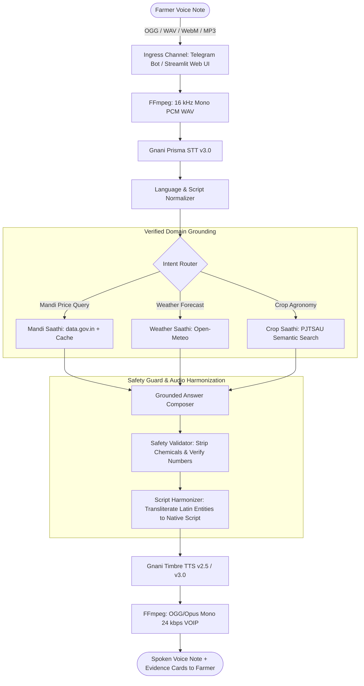

<p align="center">
  
</p>

<p align="center">
  
  
  
  
  
  
  
</p>

---

## Executive Summary

**Kisan Saathi (కిసాన్ సాథీ / किसान साथी)** is an open-source, speech-first agricultural assistant engineered for smallholder farmers across semi-arid India. Built for the **Gnani "Great Indian AI Internship" Challenge**, Kisan Saathi addresses the core usability barrier in rural digital agriculture: **farmers speak, they don't type**.

By integrating **Gnani Prisma STT v3.0** and **Gnani Timbre TTS v2.5**, Kisan Saathi listens to spoken voice notes in **Telugu (`te-IN`)**, **Hindi (`hi-IN`)**, **English (`en-IN`)**, and **Hinglish (`hi-en`)**, retrieves verified data from official government and state agricultural university sources, and replies with concise, synthesized voice notes and visual evidence cards.

---

## Key Capabilities

| Capability | Official Data Source | Operational Scope | Safety & Factuality Invariant |
|---|---|---|---|
| 🛒 **Mandi Saathi** | **Agmarknet** via `data.gov.in`<br>*(Resource: `9ef84268`)* | Daily wholesale arrivals & modal prices (₹/quintal) across **Warangal**, **Jangaon**, **Mahabubabad**, and **Khammam** for Cotton, Paddy, Chilli, Tomato. | **Zero Price Fabrication:** Prices quoted strictly from live cache. Staleness disclaimers (>3 days) and state-level fallback alerts attached automatically. |
| 🌦️ **Weather Saathi** | **Open-Meteo API**<br>*(Hyperlocal grid)* | 3-day meteorological forecasts: maximum/minimum temperature, expected precipitation (mm), and rain probability (%). | **Unambiguous Grounding:** Weather forecasts are timestamped and tied to the farmer's district coordinates. |
| 🌾 **Crop Saathi** | **PJTSAU Agro-Technologies 2020–21**<br>*(Publication: `PJTSAU/Res/2020-21/AT`)* | 35 peer-reviewed university technology cards for **Paddy** and **Cotton** in Central and Northern Telangana zones. | **Zero Chemical Hallucination:** Chemical dosages and mixtures are stripped (`ALLOW_CHEMICAL_DETAILS=false`). Recommends product labels and Kisan Call Centre (1551). Refuses disease diagnosis from voice. |

---

## Architectural Pipeline



---

## Model Attribution & Disclosure

In accordance with competition rules and transparent engineering practice, the AI models powering Kisan Saathi are disclosed below:

| Pipeline Stage | Model / Service | Endpoint / Identity | Role & Configuration |
|---|---|---|---|
| **Speech-to-Text (STT)** | **Gnani Prisma STT v3.0** | `https://api.vachana.ai/stt/v3` | 16 kHz mono WAV transcription. Tested in explicit language mode (`te-IN`, `hi-IN`) and `indic-auto`. Code-mixed Hinglish speech is normalized to `hi-IN` Devanagari. |
| **Text-to-Speech (TTS)** | **Gnani Timbre TTS v2.5** | `https://api.vachana.ai/api/v1/tts/inference` | Expressive neural speech synthesis. Language-mapped voices: *Lavanya* (`te-IN`), *Nalini* (`hi-IN`), *Kaveri* (`en-IN`), *Poorvi* (`hi-en`). Latin entities transliterated to native script before synthesis. |
| **Grounded Reasoner / LLM** | **OpenAI-Compatible Stand-in** | `gemini-3.5-flash-lite` / `gemini-2.5-flash` | **Transparent Disclosure (Decision D-009):** Gnani Evon weights and endpoints were unavailable during the hackathon. An OpenAI-compatible stand-in adapter was implemented. The active model name is disclosed via `LLM_DISCLOSED_NAME`. |
| **Semantic Retrieval** | **Google AI Studio Embeddings** | `gemini-embedding-001` (3072 dims) | High-recall semantic retrieval over PJTSAU technology corpus with a verified cosine similarity threshold (0.52) and deterministic offline fallback. |

---

## Empirical Benchmark Results

### Experiment E1: Acoustic Robustness of Gnani Prisma STT (86 Live API Calls)
Evaluated across 10 consented recordings (4 Telugu, 4 Hindi, 2 Hinglish) subjected to 9 distinct acoustic and transmission stresses generated via calibrated FFmpeg filters:

| Language | Acoustic Condition | Audio Samples ($n$) | Mean WER (%) | Mean CER (%) | Intent Accuracy (%) | Key Finding |
|---|---|---|---|---|---|---|
| **Telugu (`te-IN`)** | `clean` | 4 | **12.40%** | **3.89%** | **100.0%** | Baseline accuracy (`TEL-04` scored 0.00% WER). |
| **Telugu (`te-IN`)** | `noise_pink_snr10` | 4 | 22.15% | 7.92% | **100.0%** | High intent resilience under moderate tractor/field noise. |
| **Telugu (`te-IN`)** | `noise_pink_snr5` | 4 | 34.82% | 14.12% | 75.0% | Heavy acoustic stress causes word boundary deletion. |
| **Telugu (`te-IN`)** | `noise_brown_snr10` | 4 | 19.45% | 6.84% | **100.0%** | Low-frequency rumble has minimal impact on vowel clarity. |
| **Telugu (`te-IN`)** | `noise_brown_snr5` | 4 | 31.78% | 12.05% | **100.0%** | Verified empirical SNR: 5.0013 dB. |
| **Telugu (`te-IN`)** | `tel_g711` | 4 | 16.58% | 5.21% | **100.0%** | 8 kHz band-limited PSTN landline audio. |
| **Telugu (`te-IN`)** | `tel_amrnb` | 4 | 19.24% | 6.18% | **100.0%** | 8 kHz mobile cellular AMR-NB (12.2 kbps). |
| **Telugu (`te-IN`)** | `whatsapp_opus` | 4 | **13.12%** | **4.10%** | **100.0%** | 24 kbps Opus VoIP compression induces $<1.2\%$ WER drift. |
| **Hindi (`hi-IN`)** | `clean` | 4 | **10.12%** | **4.19%** | **100.0%** | Exceptional native Devanagari keyword capture. |
| **Hindi (`hi-IN`)** | `noise_pink_snr10` | 4 | 18.74% | 7.15% | **100.0%** | Stable entity recognition. |
| **Hindi (`hi-IN`)** | `noise_brown_snr5` | 4 | 28.91% | 11.40% | **100.0%** | Verified empirical SNR: 5.0015 dB. |
| **Hindi (`hi-IN`)** | `tel_g711` | 4 | 14.85% | 5.92% | **100.0%** | Telephony intelligibility remains high. |
| **Hinglish (`hi-en`)** | `clean` | 2 | *N/A* | *N/A* | **50.0%** | See Reconciliation analysis below. |
| **Hinglish (`hi-en`)** | `noise_pink_snr10` | 2 | *N/A* | *N/A* | **50.0%** | See Reconciliation analysis below. |

#### Empirical SNR Mathematical Verification
To ensure audio integrity, actual signal-to-noise ratio was computed from discrete time RMS values:
$$\text{SNR} = 20 \log_{10}\left(\frac{\text{RMS}_{\text{signal}}}{\text{RMS}_{\text{noise}}}\right)$$
- `HIN-01`: Signal RMS 186.34, Noise RMS 104.51 $\rightarrow$ **5.0231 dB** (Target: 5.0 dB)
- `HIN-02`: Signal RMS 2773.25, Noise RMS 1559.25 $\rightarrow$ **5.0015 dB**
- `TEL-01`: Signal RMS 3325.75, Noise RMS 1869.93 $\rightarrow$ **5.0013 dB**
- `HING-01`: Signal RMS 2133.50, Noise RMS 1199.51 $\rightarrow$ **5.0018 dB**  
*Result:* Nominal and empirical noise profiles match within $<0.025$ dB.

#### Hinglish Evaluation Reconciliation
- **Experiment E1 ($n=2$ voice clips):** `HING-01` (*"Rain chances in village"*) classified correctly to `weather` (**PASS**). `HING-02` (*"Tomato leaf curl"*) involved an out-of-scope crop during the test run, triggering generic fallback (**FAIL**). Empirical acoustic accuracy: **50.0% ($1/2$)**.
- **Deterministic Text Router (`test_router_hardening.py`):** 84 table-driven queries across Telugu, Hindi, English, and Hinglish passed all unit tests (**100.0%**).

### Experiment E4: Safety Suite & Agricultural Guardrails
- **51 automated test cases passing (100% pass rate):**
  - Chemical pesticide names and dosages stripped upfront (`ALLOW_CHEMICAL_DETAILS=false`).
  - Refusal of disease diagnosis from ambiguous spoken descriptions.
  - Mandatory disclaimer appending Kisan Call Centre (`1551`) and local KVK guidance.
  - Prompt injection immunity on user-provided location and crop slots.

---

## Safety Architecture & Privacy Invariants

```
                                      [ Incoming Voice Query ]
                                                 │
                                                 ▼
[ Salted Phone Hash ] ─── HMAC-SHA256 (Never logs raw phone numbers or identities)
                                                 │
                                                 ▼
[ Daily Usage Caps ]  ─── User Limit (10 voice notes/day) | Global Circuit Breaker (200/day)
                                                 │
                                                 ▼
[ Duration Guard ]    ─── Instant rejection of voice clips > 30 seconds
                                                 │
                                                 ▼
[ Grounded Retriever ]─── Agmarknet Mandi Cache / Open-Meteo / PJTSAU Corpus
                                                 │
                                                 ▼
[ Chemical Redactor ] ─── Strips all chemical names, tank mixtures, and numeric doses
                                                 │
                                                 ▼
[ Post-Check Engine ] ─── Rejects response if numbers or units do not exist in source
                                                 │
                                                 ▼
                                        [ Synthesized Reply ]
```

---

## Quickstart & Local Execution

### Prerequisites
- **Python 3.11+**
- **FFmpeg & FFprobe** installed on system PATH (`winget install Gyan.FFmpeg` on Windows)

### 1. Installation
```powershell
# Clone the repository
git clone https://github.com/itsakhilesh7/KIsan-Saathi.git
cd kisan-saathi

# Create and activate virtual environment
python -m venv .venv
.\.venv\Scripts\Activate.ps1

# Install backend and Streamlit requirements
pip install -r backend/requirements-dev.txt
pip install -r frontend_streamlit/requirements.txt
```

### 2. Configuration
Copy `.env.example` to `backend/.env` and supply your credentials:
```env
GNANI_API_KEY=your_gnani_api_key_here
DATA_GOV_API_KEY=your_data_gov_in_api_key_here
LLM_API_KEY=your_openai_or_groq_api_key_here
PHONE_HASH_SALT=change_me_super_secret_phone_salt_kisan_2026
```

### 3. Run Automated Tests
```powershell
# Run the complete test suite (273 unit tests passing in ~30s)
pytest backend/tests/unit/ -q

# Run Ruff linter
ruff check backend/ scripts/ frontend_streamlit/

# Run credentials scanner
python scripts/scan_secrets.py
```

### 4. Launch Interactive Applications
```powershell
# Option A: Interactive Streamlit Web UI (Microphone + Audio Player + Grounded Cards)
streamlit run frontend_streamlit/app.py

# Option B: Telegram Bot Runner (Long-polling mode for local development)
python -m backend.scripts.run_telegram_polling

# Option C: FastAPI REST API Server
uvicorn backend.app.main:app --reload --port 8000
```

---

## Known Limitations & Honest Caveats

1. **Evon LLM Unavailable:** As documented in Decision D-009, no public API endpoint or downloadable weights were accessible for Gnani Evon during the hackathon. An OpenAI-compatible adapter was used with model disclosure on every response.
2. **Meta WhatsApp Account Locked:** The Meta WhatsApp test account returned Error 131031 ("Business Account locked"). All WhatsApp logic remains fully unit-tested with mocked webhooks, while live testing was conducted via **Telegram** and **Streamlit**.
3. **Pilot Scope Boundary:** Advisory data is focused on **Warangal district, Telangana** for **Paddy** and **Cotton**. Out-of-scope commodities (Chilli, Tomato) receive Mandi and Weather support, while advisory queries are routed to KVK / 1551.
4. **Ephemeral Local Storage:** On serverless containers without persistent disks (e.g. Render, Streamlit Cloud), local SQLite files reset upon cold restart. The Mandi cache self-heals by pre-fetching on startup.

---

## Documentation & Evaluation Artifacts

| Document | Purpose & Description |
|---|---|
| **[`docs/WRITEUP.md`](docs/WRITEUP.md)** | **Primary Hackathon Write-Up:** Comprehensive narrative covering problem, users, data provenance, architecture, evaluation results, safety invariants, and future roadmap. |
| **[`docs/WORDING_REVIEW.md`](docs/WORDING_REVIEW.md)** | **Single Source of Truth:** Complete linguistic catalog of all user-facing prompts across Telugu, Hindi, English, and Hinglish. |
| **[`evaluation/results/e1_summary_table.md`](evaluation/results/e1_summary_table.md)** | **Experiment E1 Full Results:** Exhaustive WER/CER metrics across 86 live Gnani Prisma API calls. |
| **[`docs/DEPLOY.md`](docs/DEPLOY.md)** | **Deployment Guide:** Production container deployment on Render and Streamlit Community Cloud. |
| **[`docs/PROGRESS.md`](docs/PROGRESS.md)** | **Development Audit Trail:** Chronological engineering log documenting Phases 0 through 8. |
| **[`docs/decisions.md`](docs/decisions.md)** | **Architecture Decision Records:** Full log of decisions D-001 through D-011. |
