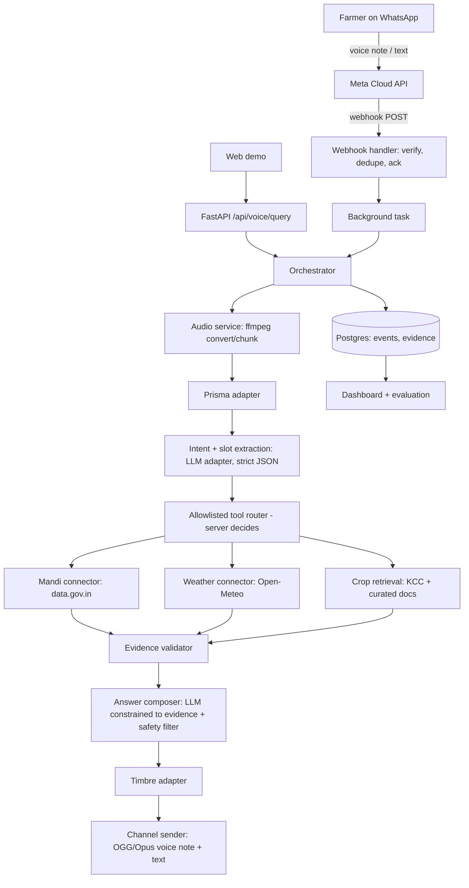

# Kisan Saathi: Architecture (v1.0)

## 1. Goals
- One intelligence pipeline, multiple channels (WhatsApp, web; others later as adapters).
- Provider code isolated and replaceable (Gnani, LLM, data.gov.in, Open-Meteo, Meta).
- Every factual claim traceable to a stored evidence record.
- Runs locally on an 8 GB laptop with no GPU; heavy parts (Evon, embeddings) are remote.

## 2. Stack
| Layer | Choice | Notes |
|---|---|---|
| API | Python 3.11, FastAPI, Pydantic v2, httpx | Async everywhere |
| Channel: WhatsApp | Meta Cloud API webhook | `backend/app/channels/whatsapp/` |
| Channel: Web | Next.js + TypeScript + Tailwind | Minimal: record/type, answer, sources |
| STT / TTS | Gnani Prisma v3.0 / Timbre v2.5 (v3.0 compared) | REST, see `docs/gnani-api-notes.md` |
| LLM | OpenAI-compatible adapter; Evon preferred | vLLM/SGLang on a rented GPU; stand-in during dev; **disclose** |
| Retrieval | pgvector (Supabase) or FAISS locally | Hosted embedding API at query time (see decisions D-008) |
| DB | Supabase Postgres | events, conversations, evidence, eval results |
| Audio | ffmpeg (+ pydub); optional silero-vad | Convert, chunk, noise/telephony simulation |
| Eval | jiwer, pandas, pytest | Reproducible scripts under `evaluation/` |
| Deploy | Vercel (web), Render/Railway/Fly (API), Supabase | Keep-alive for webhook |

## 3. System diagram


## 4. Request lifecycle (voice)
1. Webhook receives POST; verify `X-Hub-Signature-256`; parse messages; drop duplicates by message id; return 200 immediately; schedule background task.
2. Download media with the access token (media id -> URL -> bytes).
3. ffmpeg: OGG/Opus -> 16 kHz mono WAV; chunk to <= 25 s on silence if longer.
4. Prisma transcribe (`indic-auto` first; fall back to explicit language when detection looks wrong). Store transcript, detected language, request id, latency.
5. Intent/slot LLM call -> Pydantic validation. Invalid output -> one retry -> `unsupported_or_unclear`.
6. Server checks required slots. Missing -> ask one clarification (voice + text). Conversation state kept briefly per hashed user id.
7. Router executes an allowlisted tool with typed inputs; connector returns normalised **Evidence**.
8. Evidence validator checks source, dates, units, location, non-empty; attaches limitations.
9. Composer LLM writes a <= 3 sentence answer in the user's language using only the evidence; post-filter removes chemical doses (unless allowed), checks every number appears in evidence, attaches citations.
10. Timbre synthesises; ffmpeg -> OGG/Opus mono 24 kbps; upload media; send audio; send text copy.
11. Log stage timings and evidence ids. On any failure send a short fallback message in the user's language.

## 5. Repository layout
```text
backend/
  app/
    main.py
    core/            config.py (typed Settings), logging.py, security.py, ratelimit.py
    api/routes/      health.py, voice.py, mandi.py, weather.py, advisory.py, dashboard.py, evaluation.py
    channels/
      whatsapp/      webhook.py, client.py, parser.py, signature.py
      telegram/      (fallback adapter, only if needed)
    schemas/         common.py, conversation.py, intent.py, evidence.py, mandi.py, weather.py, advisory.py
    services/        orchestrator.py, intent_service.py, answer_service.py, safety.py, audio_service.py, dialogue_state.py
    integrations/
      gnani/         stt.py, tts.py, errors.py
      llm/           base.py, openai_compatible.py
      data_gov/      mandi.py, kcc.py
      weather/       open_meteo.py
      embeddings/    base.py, provider.py
    knowledge/       ingest_kcc.py, ingest_docs.py, retrieval.py, citations.py
    repositories/    events.py, conversations.py, evidence.py
  tests/             unit/, live/ (skipped without keys), fixtures/
  scripts/           test_gnani.py, eval_wer.py, build_index.py, ...
frontend/            Next.js minimal web demo
evaluation/          cases, audio_samples (consented/synthetic), results
config/              pilot.yaml
existing-code/       (starter code from earlier work; to be audited then migrated)
docs/
```
Route handlers stay thin. Business rules in `services/`. Provider specifics in `integrations/` and `channels/`.

## 6. Contracts

### 6.1 Evidence (internal, every fact passes through this)
```json
{
  "evidence_id": "stable-id",
  "source_type": "mandi_record | weather_forecast | kcc_record | advisory_document",
  "source_name": "string",
  "source_url": "https://...",
  "publisher": "string",
  "retrieved_at": "ISO-8601",
  "observation_or_publication_date": "YYYY-MM-DD | null",
  "location": "string | null",
  "data": {},
  "limitations": ["string"]
}
```

### 6.2 Intent (LLM output, strict)
```json
{
  "intent": "mandi_price_query | weather_query | crop_advisory_query | greeting_or_help | unsupported_or_unclear",
  "language": "te-IN | hi-IN | en-IN | hi-en",
  "slots": { "commodity": null, "state": null, "district": null, "market": null, "date": "latest_available",
             "crop": null, "crop_stage": null, "symptom": null, "plant_part": null, "duration": null },
  "missing_required_slots": [],
  "clarification_needed": false
}
```
Unknown = `null`. Dates/units validated in code. The model cannot name tools, URLs or sources.

### 6.3 API
- `GET /api/health`: status plus which config keys are present (never values).
- `GET|POST /webhook`: WhatsApp verification and messages.
- `POST /api/voice/query`: multipart `audio` or JSON `text`, optional `language`, `region_id`; returns transcript, language, intent, answer{text, language}, audio{available, url}, sources[], needs_clarification, clarification_question, request_id, timings.
- `GET /api/mandi/prices`, `GET /api/weather/forecast`, `POST /api/advisory/query`: typed, allowlisted filters only.
- `GET /api/dashboard/summary`: aggregated, anonymised.
- `POST /api/evaluation/run`: dev-only, protected.

## 7. Retrieval design (Crop Saathi)
1. **Sources:** KCC records from data.gov.in (state/district/crop/season/date fields as available), plus a few curated ICAR/KVK documents. Keep original URL, retrieval time, hash.
2. **Clean:** deduplicate, drop empty answers, normalise crop names, keep original text untouched in a `raw_text` column.
3. **Index:** embed `query + answer` text (not answer only) with metadata (state, district, crop, date, language). Index built offline; vectors stored in pgvector/FAISS.
4. **Retrieve:** embed the farmer's question, filter by crop/state where known, take top-k, rerank by metadata match and recency, enforce a similarity threshold.
5. **Answer:** composer sees only retrieved text; chemical content is stripped by `safety.py`; cites record ids with state/district/date.
6. **Fallback:** below threshold, conflicting, or out of corpus -> safe fallback to 1551.
7. **Eval:** held-out KCC questions compared with and without retrieval (see evaluation plan).

## 8. Data model (create only what the current phase needs; use migrations)
`regions`, `conversations` (hashed user id, language, created_at), `interactions` (transcript, intent, request_json, answer_text, status, timings jsonb, llm_disclosed_name), `evidence_records` (interaction_id, source_type, url, dates, payload jsonb), `kcc_records` (raw fields + clean fields + embedding), `advisory_documents`/`advisory_chunks`, `eval_cases`, `eval_runs`, `events` (append-only log for the dashboard).

## 9. Dialogue state
Short-lived per hashed user id (TTL ~10 min): pending intent, filled slots, last question asked. Needed so "Warangal" as a reply to "which market?" completes the mandi query. Keep it in the database or in memory with TTL; never store free-form personal data.

## 10. Security and privacy
Secrets server-side only; signature verification on webhook; allowlisted outbound hosts; upload validation; rate limits on public endpoints; CORS restricted to the web origin; hashed phone numbers; audio deleted per retention; no secrets or raw audio in logs; read-only connectors.

## 11. Observability
Per request: request_id, timestamps, channel, language, STT/LLM/tool/TTS/send latencies, model names (including `llm_disclosed_name`), evidence ids, status/error class. Written to `events` and `logs/events.jsonl` locally.

## 12. Deployment
Web on Vercel; API on a Python host with secrets; Supabase for Postgres/pgvector. Webhook must reply fast; free tiers sleep, so use a keep-alive ping or a paid always-on tier for the demo week. Evon runs on a rented GPU only for evaluation runs and demo recording unless a hosted endpoint is confirmed (see `docs/decisions.md`).

## 13. Deliberately deferred
PSTN telephony; auth; multi-state scale; fine-tuning; image diagnosis.
