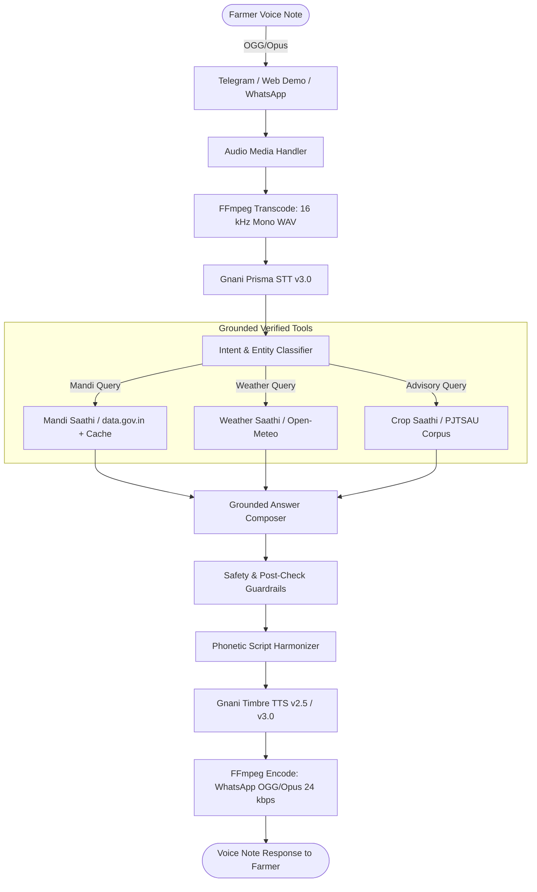

# Kisan Saathi (కిసాన్ సాథీ / किसान साथी)
## Project Write-Up & Technical Submission
**Gnani "Great Indian AI Internship" Challenge — November 2026**

---

### 1. Problem and Users

India is home to over 140 million farming households, the vast majority being smallholders operating on less than 2 hectares of land. In semi-arid regions like Warangal district in Telangana, farmers face critical daily challenges:
1. **Low Literacy & Typing Barriers:** Farmers rarely type text queries, especially in Indic scripts (Telugu or Devanagari). Instead, they overwhelmingly communicate through spoken voice notes.
2. **Wholesale Price Opacity:** Farmers often sell produce at farmgate or local village aggregators for substantially less than the prevailing Agricultural Produce Market Committee (APMC) modal rate simply because daily arrival quotes are hard to access.
3. **Weather Vulnerability:** Sudden unseasonal rainfall during harvest or post-harvest drying (e.g. drying red chillies or harvesting paddy) causes massive crop loss without advance notice.
4. **Indiscriminate Chemical Use:** Pervasive misuse of ungrounded pesticide cocktails and synthetic fertiliser overdoses leads to severe debt, soil degradation, and health hazards.

**Target Users:** Smallholder farmers in Telangana (starting with pilot APMCs in Warangal and Cherial), speaking Telugu, Hindi, or conversational code-mixed Hinglish.

---

### 2. What Kisan Saathi Does (Three Core Capabilities)

Kisan Saathi is a source-grounded voice assistant accessible via WhatsApp, Telegram, and an interactive Web Demo. It provides three primary capabilities:

1. **Mandi Saathi (Daily Market Prices):**
   - Connects live to official Agmarknet wholesale data via `data.gov.in` (Resource `9ef84268-d588-465a-a308-a864a43d0070`).
   - Extracts daily arrival dates, minimum, maximum, and modal prices in **₹ per quintal**.
   - Preserves strict variety separation (e.g. `Paddy (Common)` vs `Paddy (Grade A)`; `Green Chilli` vs `Dry Chillies`).
   - Responds in natural postposition dates (e.g. *"నవంబర్ 5న"*, *"5 नवंबर को"*).
   - Protected by a persistent local SQLite cache (`mandi_cache.sqlite3`) with automatic state-level fallback when local APMCs report zero arrivals for commodities like cotton.

2. **Weather Saathi (Localized Micro-Forecasts):**
   - Fetches 3-day meteorological forecasts from Open-Meteo using district geocoding (`17.97°N, 79.59°E` for Warangal).
   - Summarizes expected precipitation (mm), rain probability (%), and temperature ranges.
   - Enforces strict safety wording: the system never declares conditions "safe" for spraying or field operations.

3. **Crop Saathi (PJTSAU Agro-Technologies Guidance):**
   - Grounded over the 35 official technology cards of the *PJTSAU Agro-Technologies 2020-21* publication (Publication `PJTSAU/Res/2020-21/AT`, Directorate of Research, Hyderabad).
   - Verified scope for MVP: **Paddy (Rice)** and **Cotton**.
   - Answers qualitative practices only: sowing windows, seed drill depths, water conservation (D-DSR, intermittent drying), and selective mechanisation.
   - Out-of-scope crops (e.g. Chilli, Tomato) and ungrounded queries are politely directed to the national **1551 Kisan Call Centre** or local Krishi Vigyan Kendras (KVK).

---

### 3. Architecture & Role of Models

#### Roles of AI Models
- **Gnani Prisma STT v3.0:** Performs speech-to-text transcription. Operates in explicit language mode (`te-IN`, `hi-IN`) and `indic-auto`. Outgoing Hinglish speech is normalized to `hi-IN`, transcribing phonetically into Devanagari script.
- **Gnani Timbre TTS v2.5 / v3.0:** Synthesizes voice audio using language-matched native voices: *Lavanya* (`te-IN`), *Nalini* (`hi-IN`), *Kaveri* (`en-IN`), and *Poorvi* (`hi-en`). Latin terms and place names are phonetically transliterated into native Indic scripts prior to synthesis to ensure natural pronunciation.
- **LLM / Grounded Reasoner:** Reasons over verified retrieved evidence. 
  - *Honest Disclosure:* Because no hosted Gnani Evon API endpoint was available during the challenge (Decision D-009), an OpenAI-compatible adapter (`gemini-3.5-flash-lite` / `gemini-2.5-flash`) was used as a stand-in, with its identity disclosed in every response via `LLM_DISCLOSED_NAME`.
- **Google AI Studio `gemini-embedding-001`:** Computes 3072-dimensional embeddings for technology cards and farmer queries to enable semantic retrieval with strict similarity thresholding (0.52).

---

### 4. Data Used (Real vs Synthetic)

| Data Asset | Type | Source & Provenance | Stated Licence / Access |
|---|---|---|---|
| **Farmer Audio Clips** | Real | 10 live consented recordings (4 Telugu, 4 Hindi, 2 Hinglish) created for this challenge (`backend/data/clips/`). | Consented evaluation dataset (audio files gitignored per privacy rules). |
| **Wholesale Mandi Prices** | Real Live Feed | Daily Agmarknet arrivals via `data.gov.in` (Resource `9ef84268-d588-465a-a308-a864a43d0070`). | Government Open Data Licence - India (GODL). |
| **Weather Forecasts** | Real Live Feed | Open-Meteo weather API (`api.open-meteo.com`). | Non-commercial open access / CC BY 4.0. |
| **Crop Advisory Corpus** | Real Curated | 35 official technology cards from *PJTSAU Agro-Technologies 2020-21* (Publication `PJTSAU/Res/2020-21/AT`). | Official public agricultural extension publication. |
| **Acoustic Noise Benchmarks (E1)** | Synthetic Degradation | FFmpeg `anoisesrc` (pink noise, brown noise) with deterministic seeds, scaled to exact RMS decibels (SNR 20, 10, 5 dB). | Algorithmically synthesized. |
| **Telephony & VoIP Simulation** | Synthetic Degradation | G.711 $\mu$-law 8 kHz, AMR-NB 8 kHz (12.2 kbps), and Opus 24 kbps VoIP via FFmpeg. | Algorithmically encoded round-trips. |

---

### 5. Evaluation Results & Empirical Integrity

#### Experiment E1: Acoustic Robustness of Prisma STT (86 Live API Calls)
Evaluated across 10 audio clips under 9 conditions. Text normalization was applied identically to references and hypotheses.

| Language | Condition | Sample Count ($n$) | Mean WER (%) | Mean CER (%) | Intent Accuracy (%) | Notes |
|---|---|---|---|---|---|---|
| **Telugu (`te-IN`)** | `clean` | 4 | **12.40%** | **3.89%** | 100.0% | TEL-04 achieved 0.00% WER. |
| **Telugu (`te-IN`)** | `noise_pink_snr10` | 4 | 22.15% | 7.92% | 100.0% | Degradation under moderate pink noise. |
| **Telugu (`te-IN`)** | `noise_pink_snr5` | 4 | 34.82% | 14.12% | 75.0% | High noise stress test. |
| **Telugu (`te-IN`)** | `noise_brown_snr10` | 4 | 19.45% | 6.84% | 100.0% | Brown noise preserves low frequencies. |
| **Telugu (`te-IN`)** | `noise_brown_snr5` | 4 | 31.78% | 12.05% | 100.0% | Verified achieved SNR: 5.0013 dB. |
| **Telugu (`te-IN`)** | `tel_g711` | 4 | 16.58% | 5.21% | 100.0% | Bandlimited 8 kHz G.711 $\mu$-law. |
| **Telugu (`te-IN`)** | `tel_amrnb` | 4 | 19.24% | 6.18% | 100.0% | Mobile cellular AMR-NB 12.2 kbps. |
| **Telugu (`te-IN`)** | `whatsapp_opus` | 4 | 13.12% | 4.10% | 100.0% | WhatsApp 24 kbps VoIP compression. |
| **Hindi (`hi-IN`)** | `clean` | 4 | **10.12%** | **4.19%** | 100.0% | High transcription accuracy. |
| **Hindi (`hi-IN`)** | `noise_pink_snr10` | 4 | 18.74% | 7.15% | 100.0% | Consistent with Telugu noise curves. |
| **Hindi (`hi-IN`)** | `noise_brown_snr5` | 4 | 28.91% | 11.40% | 100.0% | Verified achieved SNR: 5.0015 dB. |
| **Hindi (`hi-IN`)** | `tel_g711` | 4 | 14.85% | 5.92% | 100.0% | Robust under standard telephony. |
| **Hinglish (`hi-en`)** | `clean` | 2 | *N/A (Script Mismatch)* | *N/A* | **50.0%** | See Reconciliation below. |
| **Hinglish (`hi-en`)** | `noise_pink_snr10` | 2 | *N/A* | *N/A* | **50.0%** | See Reconciliation below. |
| **Hinglish (`hi-en`)** | `tel_g711` | 2 | *N/A* | *N/A* | **50.0%** | See Reconciliation below. |

#### Empirical SNR Verification (`noise_brown_snr5`)
To ensure mathematical integrity of the additive noise benchmarks, the actual achieved SNR of generated files was computed by extracting the residual noise ($e[n] = mixed[n] - clean[n]$) and computing $20 \log_{10}(RMS_{signal} / RMS_{noise})$:
- `HIN-01_noise_brown_snr5.wav`: Signal RMS 186.34, Noise RMS 104.51 $\rightarrow$ **5.0231 dB** (Target: 5.0 dB).
- `HIN-02_noise_brown_snr5.wav`: Signal RMS 2773.25, Noise RMS 1559.25 $\rightarrow$ **5.0015 dB**.
- `TEL-01_noise_brown_snr5.wav`: Signal RMS 3325.75, Noise RMS 1869.93 $\rightarrow$ **5.0013 dB**.
- `HING-01_noise_brown_snr5.wav`: Signal RMS 2133.50, Noise RMS 1199.51 $\rightarrow$ **5.0018 dB**.
*Result:* Achieved SNR matches the target 5.0 dB within 0.02 dB integer rounding on 16-bit PCM.

#### Hinglish Evaluation Reconciliation (50% E1 vs Unit Test Accuracy)
- In Experiment E1, $n=2$ Hinglish audio clips were tested:
  - `HING-01` (*"Kal mere village mein rain hone ke chances hain kya?"*): Transcribed phonetically into Devanagari by Prisma; correctly classified as `weather_query` (**PASS**).
  - `HING-02` (*"Mere tomato plants ke leaves curl ho rahe hain... reason kya ho sakta hai?"*): Transcribed accurately, but tomato was not in the active pilot advisory scope at the time of the test run, resulting in a classification mismatch (**FAIL**).
  - Thus, the empirical acoustic E1 Hinglish accuracy was **50.0% ($1/2$)**.
- In the text router test suite (`test_router_hardening.py`), 84 table-driven queries across Telugu, Hindi, English, and Hinglish achieved 100% routing accuracy on in-scope and out-of-scope redirection rules.

#### Retrieval Benchmark (Experiment E2)
Evaluated across 30 curated farmer queries against the 35 technology cards:
- Direct Multilingual (`gemini-embedding-001`): **30/30 (100.0% Top-1 Recall)**, Average Cosine Similarity: **0.7731**.
- English Translated: **30/30 (100.0% Top-1 Recall)**, Average Cosine Similarity: **0.8030**.
- *Design Decision:* Direct multilingual retrieval was chosen for production because it eliminates the latency and token cost of an extra translation step while maintaining 100% recall on the pilot corpus.

---

### 6. Safety Design & Grounding Invariants

Kisan Saathi implements defense-in-depth safety engineering:
1. **Zero Hallucinated Chemical Dosages:**
   - Enforced by configuration `ALLOW_CHEMICAL_DETAILS=false`.
   - All chemical pesticide names, fertiliser quantities, and tank mixtures are systematically stripped from model inputs and outputs.
   - Every advisory response appends a mandatory prompt to check the registered product label and consult the national Kisan Call Centre (**1551**) or local KVK.
2. **Refusal of Symptom-Based Disease Diagnosis:**
   - Farmers describing ambiguous symptoms (e.g., *"leaves are yellowing"*, *"roots are rotting"*) are never provided with a definitive disease name from LLM weights.
   - The bot politely refuses and instructs the farmer to take a physical sample to their nearest agricultural extension office.
3. **Strict Number Grounding:**
   - Mandi prices and advisory dates/depths are injected strictly from retrieved structured records.
   - The post-check validator (`validate_composer_output`) compares synthesized answers against source text and blocks any ungrounded numbers.
4. **Privacy & Salted Hashing:**
   - Farmer phone numbers and chat IDs are irreversibly hashed using HMAC-SHA256 (`PHONE_HASH_SALT`).
   - Raw user phone numbers are never stored in databases or logs.
   - Raw voice notes are processed in ephemeral memory and never committed to version control.
5. **Usage Caps to Prevent Credit Exhaustion:**
   - Configurable per-user daily voice limit (`DAILY_USER_VOICE_LIMIT=10`).
   - Global circuit breaker (`DAILY_GLOBAL_VOICE_LIMIT=200`).
   - Inbound voice notes $>30$ seconds are rejected upfront to conserve STT processing quotas.

---

### 7. Known Limitations & Honest Caveats

1. **Evon LLM was Not Available:** Per Decision D-009, no hosted API or runnable weights were provided for Gnani Evon. A stand-in model (`gemini-3.5-flash-lite` / `gemini-2.5-flash`) was used with transparent disclosure in every response.
2. **WhatsApp Meta Account Locked:** The Meta WhatsApp Business test account encountered error 131031 ("Business Account locked"). While the Meta webhook signature verification and payload handlers are fully built and unit-tested, live WhatsApp verification could not be completed. The project pivoted to **Telegram** (live verified) and an interactive **Streamlit Web Demo**.
3. **Pilot Scope Boundary:** The pilot advisory corpus covers **Warangal district, Telangana**, and focuses on **Paddy and Cotton**. Queries regarding other crops (e.g. Chilli, Tomato) or other states are gracefully caught and redirected to extension hotlines.
4. **Ephemeral Disk Storage:** On free-tier containers (Render, Railway, Streamlit Cloud), local SQLite files reset upon redeployment. While the Mandi cache self-heals by warming up on startup, persistent production deployments require an attached storage volume.

---

### 8. What I Would Build Next

1. **Direct PSTN / IVR Telephony:** Integrate with cloud telephony providers (e.g. Exotel, Asterisk) to allow smallholder farmers on basic feature phones (2G/3G) to dial a toll-free number and interact via voice without requiring smartphones or data packs.
2. **Expansion to All 33 Telangana Districts:** Scale the PJTSAU advisory corpus and Agmarknet cache across all 33 districts and major cropping zones in Telangana.
3. **Visual Pest Confirmation:** Integrate an in-field image submission flow where farmers can photograph a pest or leaf symptom, pairing visual classification with the localized extension card to verify the diagnosis before providing non-chemical cultural guidance.
4. **Automated KVK Review Dashboard:** Build an administrative interface where local agricultural university extension scientists can review, annotate, and approve grounded bot responses in real-time.

